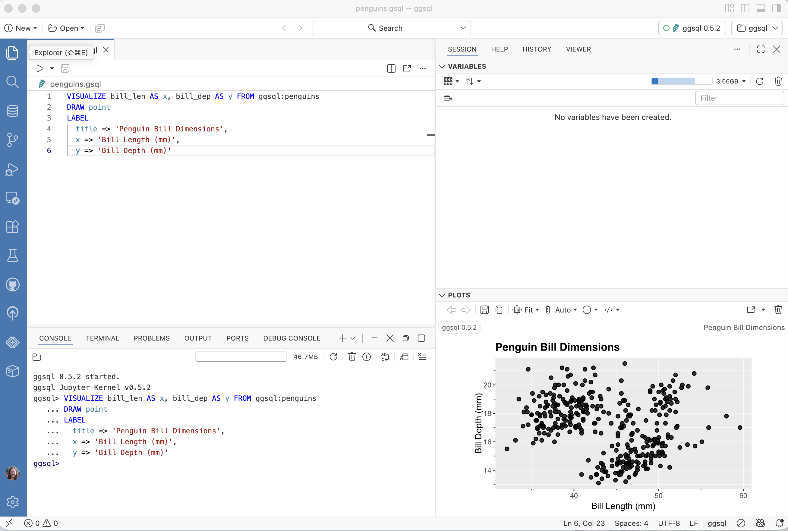
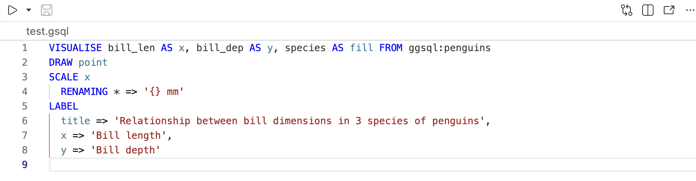

```{ggsql}
#| echo: false

-- @connect: duckdb://memory
```

The kernel **ggsql** is meant for individuals who use SQL on a regular basis and do not use either R or Python but who want to visualize their data. In other tutorials, we engage with SQL using an R engine. Even when programming is done directly in SQL chunks, the connection to the SQL server is done through R. If someone is not an R (or Python) user, they may want to still use **ggsql** as a way to (1) run SQL code and (2) visualize the results of the query (using plots which are similar to **ggplot2**). The following screenshot runs SQL code and visualizes results without R or Python. Full Quarto documents can use ggsql as the kernel and do not use either an R or a Python kernel.





## Installing

Start by installing **ggsql**: <a href = "https://ggsql.org/get_started/installation.html" target = "_blank">https://ggsql.org/get_started/installation.html</a>.

You'll need to also install **ggsql** in the extensions view in Positron (the icon on the left sidebar that looks like four squares). Click on the extensions and type "ggsql".

### ggsql code directly

Once **ggsql** is running in the extensions, **ggsql** should be an option in the `CONSOLE`.  Along with the ability to run in the console, any `.gsql` file should render.  For example, try running the following file (or type the code into the console!):



Notice that the file looks similar to a `.R` or `.py` file. There is no narrative mixed in with the code, and when you run the code, the output and images will not render within the file.

### ggsql code in Quarto

In order to run **ggsql** in Quarto, you need to have a Jupyter engine running. (Unlike R in Quarto, which is handled by a knitr engine.) That is, the Jupyter engine via a Python virtual environment. Below, we've provided vocabulary and descriptions of the process, which might help understand what is happening with different kernels and engines in Positron.

Layer 1. the language / kernel that actually exectues the code. R or Python or ggsql. These are called **kernel**s.

Layer 2. Quarto's internal machinery for talking to the kernel. Quarto calls this an "execution engine" and there are only two of them.

  - the knitr engine which is used for `{r}` cells  (also `{bash}`, `{sql}`, and `{python}` via **reticulate**)
  - the Jupyter engine which is used for `{python}`, `{ggsql}`, `{julia}` etc. cells (or `{r}` via **rpy2**)

Layer 3. Quarto which is the document / rendering tool itself. Quarto reads the `.qmd` file, decides which engine (from Layer 2) to execute, and brings together all the pieces of the analysis. Quarto can only get to Layer 1 via Layer 2. Quarto chooses exactly one Layer 2 engine per document (knitr or Jupyter but not both).


# Running ggsql

The motivation for using SQL typically derives from working with large and/or remote databases. Therefore, where the data live is an integral part of working with ggsql.


## Data from ggsql

The first ggsql example runs SQL code in a `{ggsql}` cell chunk. Note that the data come directly (and automatically) from the ggsql kernel.

```{ggsql}
#| echo: fenced

VISUALIZE bill_len AS x, bill_dep AS y, species AS fill FROM ggsql:penguins
DRAW point
SCALE x 
  RENAMING * => '{} mm'
LABEL
  title => 'Relationship between bill dimensions in 3 species of penguins',
  x => 'Bill length',
  y => 'Bill depth'
```


 
## Small data in memory

Rather than connecting to an external file or database, DuckDB can build a table directly from literal values written into the query itself, using a `VALUES` list. This creates a small in-memory table with no CSV, no R, and no Python involved at all. Note that DuckDB is `ggsql`'s default reader (in-memory).

```{ggsql}
#| echo: fenced

CREATE OR REPLACE TABLE fruit_sales AS
SELECT * FROM (
  VALUES
    ('apple',  12, 'west'),
    ('apple',  9,  'east'),
    ('banana', 18, 'west'),
    ('banana', 7,  'east'),
    ('cherry', 4,  'west'),
    ('cherry', 15, 'east')
) AS t(fruit, units_sold, region);
 
VISUALIZE fruit AS x, units_sold AS y, region AS fill FROM fruit_sales
DRAW bar
  SETTING position => 'dodge'
LABEL
  title => 'Units sold by fruit and region',
  x => 'Fruit',
  y => 'Units sold'
```
 
 

## Local DuckDB connection

Right now, **ggsql** connects only to `duckdb`, `sqlite`, and `odbc`. There are no native connections available to `mysql` or `mariadb`. DuckDB is the default reader, and we can load any csv file into a local DuckDB database.

Note that to **use** the dataset, we need to `CREATE` the relevant table so that we can query directly from it when creating visualizations.

```{ggsql}
#| echo: fenced

INSTALL httpfs;
LOAD httpfs;
CREATE OR REPLACE TABLE legodata AS
SELECT * FROM read_csv_auto('https://www.openintro.org/data/csv/lego_population.csv',
types = {'price': 'DOUBLE', 'unique_pieces': 'DOUBLE'},
nullstr = 'NA') 
WHERE theme IN ('City', 'Friends', 'Marvel')
```

```{ggsql}
#| echo: fenced

VISUALIZE price AS x, unique_pieces AS y, theme AS color FROM legodata
DRAW point
LABEL
  title => 'LEGO set price vs. unique pieces, by theme',
  x => 'Price',
  y => 'Unique pieces'
```


## Remote connection

### Parquet files

As before, the remote file needs to be `CREATE`d before it can be used in the VISUALIZE syntax.

```{ggsql}
#| echo: fenced

CREATE OR REPLACE TABLE nyc_taxi AS
SELECT * FROM read_parquet('https://arrow-datasets.s3.amazonaws.com/nyc-taxi-tiny/year=2019/month=1/part-0.parquet')
```

```{ggsql}
#| echo: fenced

VISUALIZE fare_amount AS y, trip_distance AS x, passenger_count AS color FROM nyc_taxi
DRAW point
LABEL
  title => 'Taxi rides in NYC in 2019',
  y => 'Price of taxi fare ($)',
  x => 'Distance of taxi ride (mi)'
```


### MariaDB server

Unlike the connections to SQL servers that can be done seamlessly using an R or a Python kernel, the ggsql kernel requires additional set up to access remote SQL servers.^[It is our hope and expectation that the Posit team is actively working on the remote connection aspect which will become easier in time to navigate.]

In what follows, we will connect to the <a href = "https://relational.fel.cvut.cz/dataset/IMDb" target = "_blank">IMDb MariaDB database</a> hosted by the <a href = "https://relational.fel.cvut.cz/" target = "_blank">CTU Relational Learning Repository</a>.

**ggsql** has no native MariaDB/MySQL reader — only `duckdb://`, `sqlite://`, and `odbc://`. So connecting to a MariaDB server (like the public <a href = "https://relational.fel.cvut.cz/" target = "_blank">CTU database</a>) goes through **ODBC**, which requires a driver manager (unixODBC) plus a database-specific driver (the MariaDB Connector/ODBC) to be installed and registered at the OS level, independent of **ggsql** itself.

**A critical architecture note for Apple Silicon Macs:** `ggsql` is a native `arm64` binary. If your Homebrew install is the Intel (`x86_64`) build running under Rosetta — which happens if Homebrew was originally installed before switching to an Apple Silicon Mac, or installed without forcing the arm64 architecture — it lives under `/usr/local` rather than `/opt/homebrew`, and any driver it builds will also be `x86_64`. A native `arm64` program like `ggsql` **cannot load an `x86_64` shared library**; the two are binary-incompatible, not just a path mismatch. If you hit an error like `ODBC driver manager not found` or `incompatible architecture (have 'x86_64', need 'arm64')`, this mismatch is the cause.

Check which Homebrew you have before proceeding:

```bash
file $(which brew)
```

If this reports `/usr/local/bin/brew` and your Mac has an Apple Silicon chip (M1/M2/M3/M4), install a second, native Homebrew at `/opt/homebrew` rather than fighting the existing one:

```bash
arch -arm64 /bin/bash -c "$(curl -fsSL https://raw.githubusercontent.com/Homebrew/install/HEAD/install.sh)"
eval "$(/opt/homebrew/bin/brew shellenv)"
```

Add that `eval` line to your `~/.zshrc` (or `~/.bash_profile`) so `/opt/homebrew` stays first on `PATH` in future terminal sessions.

### 1\. Install unixODBC and the MariaDB ODBC driver

```bash
brew install unixodbc mariadb-connector-odbc
```

If you have both an Intel and an Apple Silicon Homebrew, make sure this command runs under the `/opt/homebrew` `brew` (confirm with `which brew`).

### 2\. Confirm where the driver manager expects its config files, and locate the installed driver

```bash
odbcinst -j
```

This reports the actual paths unixODBC will read from — typically `/opt/homebrew/etc/odbcinst.ini` and `/opt/homebrew/etc/odbc.ini` on Apple Silicon, or `/usr/local/etc/...` on Intel. Use _these_ paths, not an assumed one, since a stray second unixODBC install can report different paths than you expect.

Then find the actual driver library file Homebrew installed, since its exact path is needed in the next step:

```bash
find "$(brew --prefix mariadb-connector-odbc)" -iname "libmaodbc.dylib"
```

### 3\. Register the driver in `odbcinst.ini`

Using the paths and driver location from step 2, create or edit `odbcinst.ini`:

```ini
[MariaDB]
Description = MariaDB ODBC Driver
Driver      = /opt/homebrew/Cellar/mariadb-connector-odbc/<version>/lib/mariadb/libmaodbc.dylib
```

(Replace `<version>` with whatever `find` reported.)

### 4\. Add a DSN in `odbc.ini` for the specific server

A DSN (Data Source Name) is a named connection profile. Add a section named for your server — here, `imdb` — to the `odbc.ini` path reported by `odbcinst -j`:

```ini
[imdb]
Driver   = MariaDB
Server   = relational.fel.cvut.cz
Port     = 3306
Database = imdb_ijs
User     = guest
Password = ctu-relational
```

### 5\. Test the DSN before involving ggsql

Confirm the connection works at the ODBC level first, so any remaining errors are isolated to ggsql rather than the driver setup:

```bash
echo "SELECT 1;" | isql -v imdb guest ctu-relational
```

A `Connected!` banner and a one-row result confirm success.

### 6\. Connect from ggsql

Finally, we connect to the databse from within the Quarto document using the `jupyter: ggsql` engine, with the `-- @connect:` comment to switch the session's active connection:

```{ggsql}
#| echo: fenced

-- @connect: odbc://DSN=imdb
SELECT * FROM actors LIMIT 5
```

Each `{ggsql}` chunk in a document shares the same kernel session, so this connection stays active for subsequent chunks until another `@connect:` is issued.

Note, however, that in order to visualize the data, it needs to be local in the DuckDB database. To do so, we open a new DuckDB link using `-- @connect: duckdb://memory`, run the SQL query, and then `VISUALIZE` the data as desired.

**ggsql** still does not have options like tilting the labels on the x-axis, so we rotated the graph in order to be able to read the genres.

```{ggsql}
#| echo: fenced

-- @connect: duckdb://memory

INSTALL mysql;
LOAD mysql;
ATTACH 'host=relational.fel.cvut.cz port=3306 user=guest password=ctu-relational database=imdb_ijs' AS imdb (TYPE mysql);

SELECT genre, gender, COUNT(*) AS n_roles
FROM imdb.roles r
JOIN imdb.actors a ON r.actor_id = a.id
JOIN imdb.movies_genres mg ON r.movie_id = mg.movie_id
GROUP BY genre, gender

VISUALISE genre AS x, n_roles AS y, gender AS fill
DRAW bar
PROJECT y, x TO cartesian
LABEL
  title => 'Count of acting roles by genre and gender',
  x => 'Genre',
  y => 'Count of roles'
```


## Resources

Thanks to the group at Posit who has provided many resources for working with **ggsql**. Many of the examples above are taken from the Posit resources.

* Main resource <a href = "https://ggsql.org/" target = "_blank">website for ggsql</a>. The resource includes information for installation, syntax for working through ggsql, and a gallery of plots.

* Posit blog on <a href = "https://opensource.posit.co/blog/2026-04-20_ggsql_alpha_release/" target = "_blank">ggsql: A grammar of graphics for SQL</a>.

* Julia Silge's 2026 posit::conf talk on <a href = "https://juliasilge.github.io/posit-conf-2026-sql-in-positron/" target = "_blank">SQL as a first-class language in your data science IDE</a>


